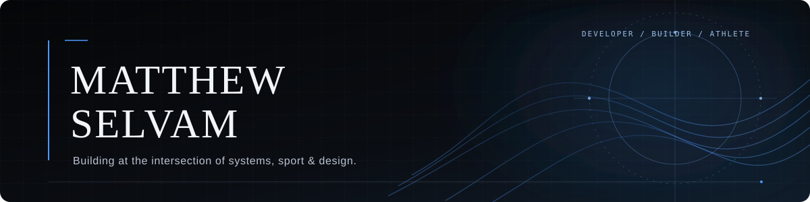

<!--
  Matthew Selvam — GitHub profile README
  Visual system: near-black / graphite / white, with restrained electric-blue accents.
  GitHub's native contribution graph keeps its familiar green palette.
-->

 

  

<code>DEVELOPER</code> &nbsp; / &nbsp; <code>BUILDER</code> &nbsp; / &nbsp; <code>ATHLETE</code> &nbsp; / &nbsp; <code>CREATIVE</code>

---

## 01 / SELECTED WORK

<table>
<tr>
<td width="50%" valign="top">

### ◈ [Open Dispatch](https://github.com/Matthew-Selvam/Open-Dispatch)

A self-hosted, extensible automation platform for content, data and workflows.

PYTHON · N8N · DOCKER · POSTGRES

</td>
<td width="50%" valign="top">

### ⌁ [EdgeLab](https://github.com/Matthew-Selvam/EdgeLab)

A sports prediction and model evaluation platform for football, built around Elo, Poisson and market benchmarks.

PYTHON · STREAMLIT · PANDAS · SCIPY

</td>
</tr>
<tr>
<td width="50%" valign="top">

### ↗ Sprint Lab

A track-performance analytics project exploring progression, consistency and event-level comparisons.

PYTHON · STREAMLIT · ANALYTICS · VISUALISATION

</td>
<td width="50%" valign="top">

### ⌘ [More experiments](https://github.com/Matthew-Selvam?tab=repositories)

A growing collection of tools, experiments and open-source work.

BUILD · TEST · ITERATE

</td>
</tr>
</table>

---

## 02 / ELSEWHERE

&nbsp;

&nbsp;

---

## 03 / CONTRIBUTION ACTIVITY

&nbsp;

---

## 04 / AI USAGE

---

<code>MATTHEW SELVAM</code> &nbsp; · &nbsp; <code>ALWAYS BUILDING.</code>

  

